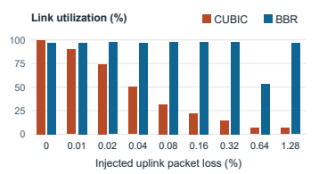
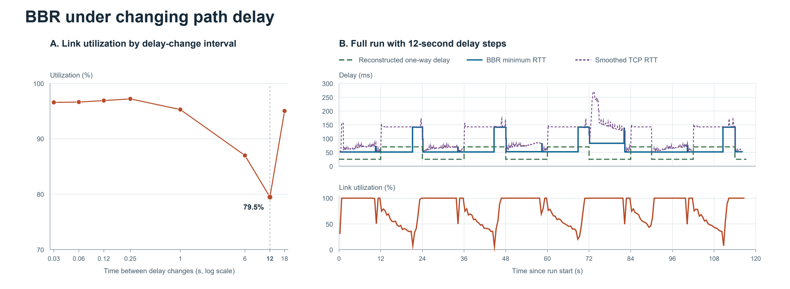
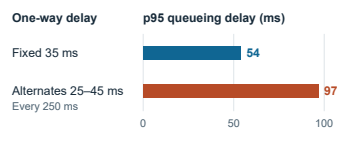
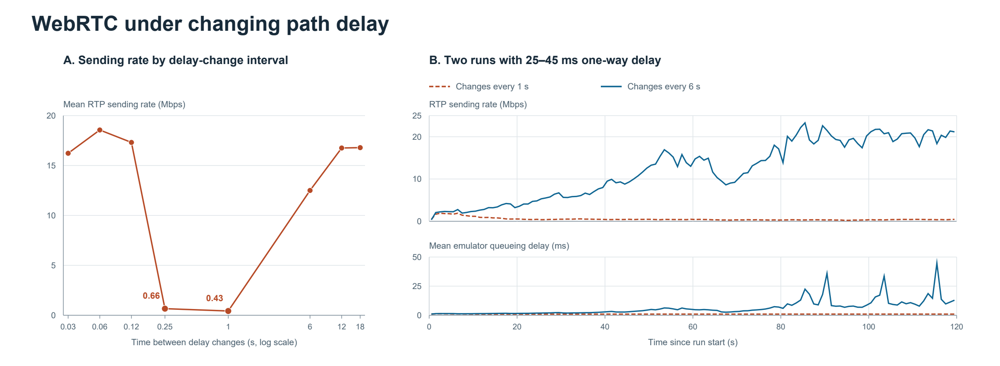
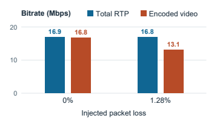

## From in-flight Wi-Fi to direct-to-cell

If you’ve sent a message over Wi-Fi on a recent United flight, it may have traveled through a Starlink satellite. <a href="https://starlinktracker.united.com/program/starlink" title="United Airlines Starlink Wi-Fi tracker">[1]</a> Starlink also connects homes, businesses, and ships. As of September 30, 2026, SpaceX reported **13.6 million Starlink consumer subscribers**. <a href="https://www.sec.gov/Archives/edgar/data/1181412/000162828026066482/spaceexplorationtechnologi.htm" title="SpaceX third-quarter 2026 results">[2]</a>

T-Mobile also uses Starlink to connect compatible phones directly to satellites in places without terrestrial coverage. The service supports texting, including text-to-911 where available. <a href="https://www.t-mobile.com/coverage/satellite-phone-service" title="T-Mobile T-Satellite coverage and features">[3]</a>

## Could satellite backhaul become routine?

In late 2024 and early 2025, I started wondering whether Starlink could become a routine option for cellular backhaul. Your phone would connect to a terrestrial base station as usual, and a satellite link would carry that base station’s traffic to the mobile core. SpaceX had already reported that Starlink’s median U.S. peak-hour latency had fallen from about 49 ms to 33 ms. <a href="https://starlink.com/public-files/StarlinkLatency.pdf" title="SpaceX report on Starlink latency, 2024">[4]</a> I wanted to see how much more widely operators could use satellite backhaul as latency and packet loss came down and capacity increased.

Operators already used satellite backhaul in several settings. In 2021, KDDI selected Starlink to connect remote base stations in Japan. <a href="https://news.kddi.com/kddi/corporate/english/newsrelease/2021/09/13/5400.html" title="KDDI selects Starlink for cellular backhaul">[5]</a> Satellite links can also connect temporary cell sites at large events <a href="https://www.verizon.com/business/en-en/products/networks/on-site-5g/temporary-network/" title="Verizon temporary cellular networks and backhaul options">[6]</a> or help restore cellular coverage after a disaster damages fiber. <a href="https://www.verizon.com/about/news/verizon-conquers-remaining-dead-zones-test-man-buzz-aldrin" title="Verizon uses of satellite backhaul, including when fiber is damaged">[7]</a>

SpaceX’s move into mobile makes the question timely again. The FCC approved its EchoStar spectrum deal, and EchoStar still targets November 2027 for the final closing. <a href="https://www.sec.gov/Archives/edgar/data/1415404/000110465926121675/sats-20260930x10q.htm" title="EchoStar third-quarter 2026 filing and spectrum deal status">[8]</a> SpaceX has reportedly sought access to at least 80,000 U.S. cell sites. <a href="https://www.investing.com/news/stock-market-news/spacex-seeks-access-to-80000-us-cell-sites-for-wireless-network-bloomberg-news-reports-4967805" title="Reuters on reported SpaceX discussions for U.S. cell-site access">[9]</a> Qualcomm will supply equipment and software for its planned terrestrial 5G network. <a href="https://www.qualcomm.com/news/releases/2026/11/spacex-selects-qualcomm-to-accelerate-starlink-mobile-s-nationwi" title="Qualcomm announcement of the Starlink Mobile terrestrial 5G agreement">[10]</a>

## Two wireless links in series

The cellular access link connects a phone to its serving base station. The Starlink backhaul carries traffic from the base station toward the mobile core through a satellite terminal at the site. The first link serves individual phones. The second carries their combined traffic.

<table>
<thead>
<tr>
<th></th>
<th>Cellular access</th>
<th>Starlink backhaul</th>
</tr>
</thead>
<tbody>
<tr>
<td><strong>Distance and propagation</strong></td>
<td>A 1 km radio path takes about 3 microseconds one way.</td>
<td>At 550 km, the hop to a satellite directly overhead takes about 1.8 ms. The signal still has to reach a ground gateway. <a href="https://news.kddi.com/kddi/corporate/english/newsrelease/2021/09/13/5400.html" title="KDDI selects Starlink for cellular backhaul">[5]</a></td>
</tr>
<tr>
<td><strong>Measured one-way delay</strong></td>
<td>Under 1 ms at the physical layer in favorable conditions in our commercial millimeter-wave 5G measurements. <a href="https://www-users.cse.umn.edu/~fengqian/paper/5glatency_pam23.pdf" title="Fezeu et al., PAM 2023, An In-Depth Measurement Analysis of 5G mmWave PHY Latency and Its Impact on End-to-End Delay">[11]</a></td>
<td>Baselines of 13 ms down and 17 ms up on a mostly idle path between a Starlink client and a cloud server. <a href="https://hendrikcech.com/documents/cech2026dissecting.pdf" title="Cech et al., SIGCOMM 2026, Dissecting the StarLink">[12]</a></td>
</tr>
<tr>
<td><strong>Scheduling and contention</strong></td>
<td>The base station assigns time and frequency resources to phones. Users in the same cell compete for those resources under load. <a href="https://www.etsi.org/deliver/etsi_ts/138300_138399/138300/17.09.00_60/ts_138300v170900p.pdf" title="3GPP TS 38.300, NR and NG-RAN Overall Description, section 10">[13]</a></td>
<td>Starlink allocates bandwidth to the terminal based on demand. Traffic from the cell shares that allocation. <a href="https://hendrikcech.com/documents/cech2026dissecting.pdf" title="Cech et al., SIGCOMM 2026, Dissecting the StarLink">[12]</a></td>
</tr>
<tr>
<td><strong>Queueing and fairness</strong></td>
<td>Separate downlink queues for each phone’s radio bearers provide some isolation when the cell has capacity to spare. Under load, throughput shares depend on the scheduler. <a href="https://upcommons.upc.edu/bitstream/2117/355602/3/IEEE_Access_Mikel_Irazabal.pdf" title="Irazabal et al., IEEE Access 2021, Preventing RLC Buffer Sojourn Delays in 5G">[14]</a></td>
<td>One study found some delay isolation between flows and shared downlink loss. Another found unequal throughput for competing TCP flows. <a href="https://hendrikcech.com/documents/cech2026dissecting.pdf" title="Cech et al., SIGCOMM 2026, Dissecting the StarLink">[12]</a> <a href="https://arxiv.org/pdf/2605.27717" title="Garcia et al., IMC 2026, Characterizing the Configuration of Starlink Queuing">[15]</a></td>
</tr>
</tbody>
</table>

**Starlink backhaul.** Even a stationary dish can change serving satellites. In SIGCOMM ’26 measurements, Starlink’s synchronized **15-second reconfigurations** briefly interrupted packet delivery, reset bandwidth allocations, and could shift baseline delay. Changes also occurred when the serving satellite stayed the same. On a mostly idle link, UDP probe loss between reconfigurations averaged **0.02–0.03%** and rose briefly at the boundary. <a href="https://hendrikcech.com/documents/cech2026dissecting.pdf" title="Cech et al., SIGCOMM 2026, Dissecting the StarLink">[12]</a> An earlier low-rate UDP study averaged **0.24% down and 1.24% up**. <a href="https://arxiv.org/pdf/2212.13697" title="Ma et al., INFOCOM 2023, Network Characteristics of LEO Satellite Constellations">[16]</a> SatGuard measured **3–15%** loss during short bursts in one web session. <a href="https://doi.org/10.1145/3589334.3645639" title="Li et al., WWW 2024, SatGuard">[17]</a>

**Cellular access.** Per-user throughput varies with spectrum, radio conditions, and cell load. In our 5G measurements, handovers could temporarily disrupt application traffic. <a href="https://arvindn.com/publications/SIGCOMM22-5GMobility.pdf" title="Hassan et al., SIGCOMM 2022, Vivisecting Mobility Management in 5G Cellular Networks">[18]</a> Radio retransmissions help recover lost data and can add delay. <a href="https://www-users.cse.umn.edu/~fengqian/paper/5glatency_pam23.pdf" title="Fezeu et al., PAM 2023, An In-Depth Measurement Analysis of 5G mmWave PHY Latency and Its Impact on End-to-End Delay">[11]</a> A campus Zoom study still observed more packet loss and jitter on cellular than on Wi-Fi in its dataset. <a href="https://olivermichel.github.io/doc/domino-imc25.pdf" title="Yi et al., IMC 2025, Automated Cross-Layer Root Cause Analysis of 5G">[19]</a>

**What the sender sees.** Either link can become the bottleneck. A backhaul slowdown can affect many users at once, even when their cell has radio capacity to spare. A sender sees the resulting delay and loss across the whole path. A jump in delay might mean a queue is growing on either link, or that Starlink’s baseline delay just changed.

## Some questions we wanted to answer

- What happens to packet delivery when a phone hands over to another cell just as Starlink reconfigures?
- When does the bottleneck move between cellular access and satellite backhaul, and can we tell where packets are waiting?
- How do changes in path delay and packet loss affect TCP throughput and queueing delay during large downloads?
- How do those changes affect a video call, from the quality and smoothness of the video to the delay people experience?
- How sensitive are cellular procedures such as establishing a data session to delay and loss on the backhaul?
- Could the Starlink backhaul prioritize cellular control-plane messages and delay-sensitive traffic such as voice calls when capacity is limited?
- Could the base station use backhaul capacity estimates to schedule users, and could the backhaul use the state of the radio queues to decide which packets to send first?
- What changes to congestion control, queue management, or coordination between the two links could reduce the impact of handovers, reconfigurations, and packet loss?

## Early insights

We tested two workloads with different demands. For a **backlogged TCP transfer**, such as a large download or software update, the sender always has more data ready and throughput largely determines how soon the transfer finishes. For **real-time video**, frames have to arrive in time for playback. Queueing delay during a bulk transfer can also matter to other traffic sharing the link. For example, a page loading over **HTTP/2** can stall while the browser waits for a response it needs to request the next resource. <a href="https://www.rfc-editor.org/rfc/rfc9113.html#name-http-2-protocol-overview" title="RFC 9113, HTTP/2 over TCP">[20]</a>

For bulk transfers, we ran one TCP connection at a time, focusing on CUBIC and BBR, two widely deployed congestion controllers. <a href="https://www.rfc-editor.org/rfc/rfc9743.html" title="RFC 9743, deployment of CUBIC and BBR">[21]</a> We measured both transfer throughput and queueing delay. For real-time video, we ran a WebRTC sender and receiver using Google Congestion Control (GCC) and recorded bitrate, frame delivery, and delay. <a href="https://webrtc.googlesource.com/src.git/%2B/fc7ec8e9f8b67033bcb5516268c0442653ef34e6/modules/congestion_controller/goog_cc/delay_based_bwe.cc" title="WebRTC&#39;s Google Congestion Control implementation">[22]</a> We used **mmlight**, a modified version of Mahimahi, to vary delay or inject loss while holding capacity at 24 Mbps in each direction. <a href="https://www.usenix.org/system/files/conference/atc15/atc15-paper-netravali.pdf" title="Netravali et al., Mahimahi">[23]</a>

### Prerequisite — TCP under packet loss

Starlink has lowered its latency, and longitudinal measurements have found periods of declining packet loss. The satellite hop still adds propagation delay compared with local Wi-Fi, cellular, or wired access. Reconfigurations can also cause brief loss spikes. <a href="https://starlink.com/public-files/StarlinkLatency.pdf" title="SpaceX report on Starlink latency, 2024">[4]</a> <a href="https://vaibhavbajpai.com/documents/papers/proceedings/starlink-networking-2025.pdf" title="Ververis et al., IFIP Networking 2025, Breaking Through the Clouds">[27]</a> <a href="https://hendrikcech.com/documents/cech2026dissecting.pdf" title="Cech et al., SIGCOMM 2026, Dissecting the StarLink">[12]</a>

CUBIC reduces its sending rate when it detects loss. <a href="https://www.rfc-editor.org/rfc/rfc9438.html#section-4.6" title="RFC 9438, CUBIC response to packet loss">[28]</a> We ran CUBIC and BBR separately on a 24 Mbps link with a fixed 35 ms one-way delay. At **0.08%** injected uplink loss, CUBIC used **32%** of the link and BBR used **98%**. At **0.32%** loss, CUBIC used just **15%**. BBR used more capacity at every nonzero loss rate in the sweep. Earlier experiments found that BBRv1 could also take a larger share from competing CUBIC flows at shallow queues. <a href="https://web.cs.wpi.edu/~claypool/papers/bbr/bbr-aict-19.pdf" title="Study of BBR and CUBIC coexistence">[26]</a> We focused on BBR for the TCP delay experiments that follow.

<figure class="post-figure"></figure>

### BBR and Starlink reconfigurations

Starlink reconfigurations can shift the path’s baseline delay. <a href="https://hendrikcech.com/documents/cech2026dissecting.pdf" title="Cech et al., SIGCOMM 2026, Dissecting the StarLink">[12]</a> To see how BBR responds, we switched between 25 and 70 ms of one-way delay at different intervals, with zero injected loss. BBR used **79.5%** of the link when delay changed every 12 seconds, compared with about **95%** at 1- and 18-second intervals. Across the three 12-second runs, utilization was **77–81%**. Utilization is achieved throughput divided by the configured 24 Mbps.

BBR uses its bandwidth and minimum round-trip time (RTT) estimates to decide how much data to keep in flight. After each of the first three delay increases in the trace, the minimum RTT estimate stayed near **51–52 ms** for about nine seconds. An estimate that stays too low can leave too little data in flight to fill the link. Utilization fell during those periods and recovered after the estimate refreshed.

We used BBRv1 for these measurements. The current IETF draft specifies a **10-second minimum-RTT window**. Google’s public BBR implementation retains that window and uses a separate **five-second threshold** for triggering an active RTT probe. With Starlink reconfigurations measured every 15 seconds, how those delay changes line up with BBR’s RTT sampling remains worth testing on newer builds. <a href="https://datatracker.ietf.org/doc/html/draft-ietf-ccwg-bbr-07#section-5.3.4" title="IETF BBR draft, minimum RTT estimation and ProbeRTT">[24]</a> <a href="https://github.com/google/bbr/blob/v3/net/ipv4/tcp_bbr.c" title="Google BBRv3 Linux source, minimum RTT filter and ProbeRTT trigger">[25]</a>

<figure class="post-figure"></figure>

### BBR and queueing delay

Many TCP applications depend on short response times. When you load a web page or an app makes a request to a server, time spent waiting in a queue can delay the next action. We wanted to see how changing the path delay affected queueing while a BBR flow kept the link busy.

We ran one backlogged TCP flow at a time on a 24 Mbps link with zero injected loss. We compared a fixed **35 ms** one-way delay with a profile that alternated between **25 and 45 ms** every **250 ms**, with the same average configured delay. BBR sustained about **23.3 Mbps** in both runs shown. The **95th-percentile uplink queueing delay** rose from **54 ms** with fixed delay to **97 ms** in the second variable-delay run, the higher of the two repeats in that batch.

<figure class="post-figure"></figure>

### WebRTC and the timing of delay changes

A **20 ms swing in one-way delay** was enough to push WebRTC below **1 Mbps** at some intervals. To model end-to-end jitter on a path that crosses cellular access and satellite backhaul, we alternated between **25 and 45 ms** on a 24 Mbps link with zero injected loss. Across one run per interval, WebRTC averaged **0.66 Mbps** with changes every 250 ms, **0.43 Mbps** with changes every second, and **12.5–18.6 Mbps** at the other intervals. In a separate comparison, the sender started sending about **8 frames per second** with 1-second changes and **48** at a fixed 45 ms.

GCC estimates whether a queue is growing by comparing the spacing between packet groups at the sender and receiver. A jump in the path’s baseline delay can stretch the gaps at the receiver and trigger a rate cut. <a href="https://webrtc.googlesource.com/src.git/%2B/fc7ec8e9f8b67033bcb5516268c0442653ef34e6/modules/congestion_controller/goog_cc/delay_based_bwe.cc" title="WebRTC&#39;s Google Congestion Control implementation">[22]</a> In the plotted 1-second run, the emulator’s uplink queue stayed near 1 ms. In a separate run with the same delay profile, the sender logged successful bandwidth probes and still sustained a low sending rate.

One possibility is that the fastest swings largely canceled out in GCC’s delay estimate, while longer intervals gave the sender time to recover. At 250 ms and 1 second, repeated increases may have triggered rate cuts before the sender could recover. We’d need GCC’s delay trend, overuse state, and target bitrate over time to test that explanation.

<figure class="post-figure"></figure>

### WebRTC under packet loss

We wanted to know how much of a call’s sending rate still goes to encoded video when packets are lost. WebRTC can send extra data as forward error correction (FEC), which lets the receiver recover some missing packets without waiting for retransmissions. We varied packet loss while holding the link at 24 Mbps and one-way delay at 45 ms. <a href="https://www.rfc-editor.org/rfc/rfc8854.html#section-8" title="RFC 8854, adaptive forward error correction in WebRTC">[29]</a>

At **1.28%** loss, the total RTP rate stayed near **17 Mbps** while encoded video fell from **16.8 to 13.1 Mbps**. The sender logged about **3.2 Mbps** of FEC at that setting. We saw a similar pattern across **0.32–1.28%** loss. At **2.56%**, the total RTP rate fell to **11.5 Mbps**, with **8.4 Mbps** of encoded video.

<figure class="post-figure"></figure>

## What we learned and what remains

We wanted to understand what could go wrong when cellular access and satellite backhaul operate in series, then build something to keep applications responsive through handovers, reconfigurations, and packet loss.

The experiments answered some of those questions. BBR sustained more throughput than CUBIC under packet loss, and the timing of delay changes affected BBR’s link utilization and WebRTC’s sending rate. At the same average path delay, alternating delay increased queueing while TCP throughput stayed steady. With modest packet loss, WebRTC sent less encoded video as it allocated more bitrate to loss recovery. We still don’t know what happens when both links change at the same time, or how much prioritizing cellular signaling and delay-sensitive traffic would help.

In early srsRAN tests, some control-plane procedures took longer when we added delay to the emulated backhaul. We’d need more realistic experiments to confirm the latency impact and determine whether these procedures also fail more often.

We tried a TCP proxy that split a connection between the two links so each half could respond to its own link conditions. We tested it under fixed conditions and were still measuring the effects of delay and loss when I stepped away. Evaluating a design under the handovers and reconfigurations that motivated the project is still open.

My thesis defense, job search, and other projects took priority, and I don’t expect to pick this up again soon. If you’re interested in working on it, I’m happy to share the code, experiment setup, and notes.

## Acknowledgments

Thanks to Ammar Tahir for his insights and for sharing his WebRTC setup, and to my advisor Feng Qian for his guidance.
